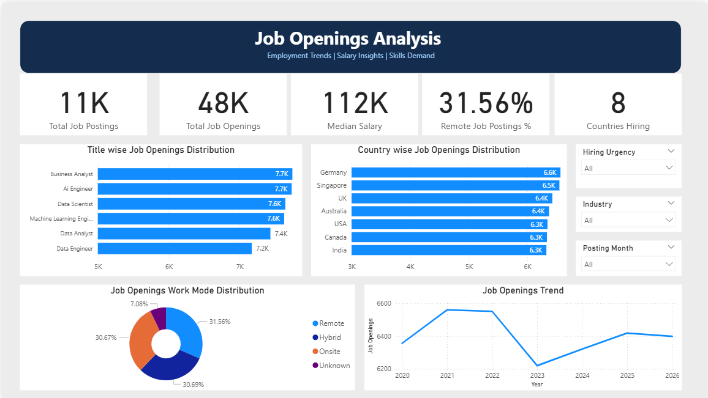

# Job Postings Analysis Dashboard | Power BI

An interactive three-page Power BI dashboard exploring job openings, salary patterns, and in-demand skills using a dataset containing over 10,000 records and 22 columns.

## Project Overview

This project analyzes job posting data to explore hiring patterns, salary differences, work arrangements, and skill requirements.

The raw dataset required cleaning and transformation before analysis. I used Advanced Excel and Power Query to prepare the data, then developed an interactive dashboard in Microsoft Power BI.

## Dashboard Preview

### 1. Job Openings Analysis
Explores the distribution of job openings by job title, location, work mode, and posting trends over time.

### 2. Salary Analysis
Examines salary patterns across job roles, industries, experience levels, and education levels.

              

### 3. Skills Overview
Explores the demand for technical skills, including Python, SQL, Cloud, Machine Learning, and Deep Learning.

## Dataset Overview

- **Records:** 10,000+
- **Columns:** 22
- **Subject:** Company job openings
- **Data preparation tools:** Advanced Excel and Power Query

The dataset includes information related to job titles, salaries, locations, work modes, experience levels, education requirements, and skills.

## Data Cleaning and Transformation

The data preparation process involved:
- Inspecting the raw dataset.
- Cleaning and transforming data using Advanced Excel and Power Query.
- Preparing fields for consistent analysis.
- Organizing the data for visualization in Power BI.

## Analysis Areas

### Job Openings Analysis
- Distribution of job openings across job titles and locations.
- Breakdown of remote, hybrid, and onsite opportunities.
- Job posting trends over time.

### Salary Analysis
- Salary comparisons across job roles.
- Salary patterns by industry.
- Analysis by experience and education levels.

### Skills Overview
- Exploration of in-demand technical skills.
- Comparison of skill demand across categories.
- Analysis of skills such as Python, SQL, Cloud, Machine Learning, and Deep Learning.

## Tools and Technologies

- Microsoft Power BI
- Microsoft Excel
- Power Query

## Repository Contents

- **Dashboard:** Interactive Power BI report (`.pbix`).
- **Screenshots:** Images of the three dashboard pages.
- **Dataset:** Original job postings dataset.
- **README.md:** Project documentation.

## Project Objective

The objective was to apply data cleaning, transformation, analysis, and visualization techniques to explore patterns in job posting data and communicate findings through an interactive dashboard.
